# Shyna em Sonic CD

**Uma fusão de dois jogos: a Shyna, de _Silhouette Mirage_ (Sega Saturn), jogável dentro das fases de _Sonic CD_ (Sega CD), com os golpes, a física e os parasitas do jogo dela.**

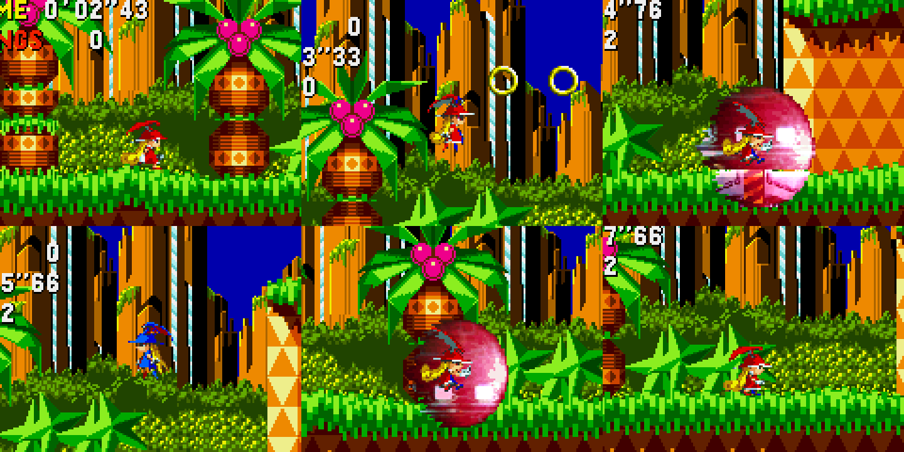

Os dois jogos rodam ao mesmo tempo, dentro de um único programa. O Sonic CD desenha o mundo; o Silhouette Mirage roda escondido e fornece a personagem. Nenhum dos dois foi reescrito ou descompilado.

> [!WARNING]
> **Este projeto não está 100% finalizado e ainda tem bugs.** Só foi testado na primeira fase (Palmtree Panic 1), não tem som, e várias situações do jogo ainda não foram exercitadas. A lista honesta do que funciona e do que não funciona está [mais abaixo](#estado-atual).

> [!IMPORTANT]
> **Este repositório não contém jogos, BIOS nem emuladores**, só código e capturas de tela. Para rodar você precisa das suas próprias cópias dos dois jogos e dos BIOS dos consoles. Os nomes exatos dos arquivos estão em [Como rodar](#como-rodar).

---

## Índice

- [Estado atual](#estado-atual)
- [Como rodar](#como-rodar)
- [Controles](#controles)
- [Como funciona](#como-funciona)
- [A jornada, passo a passo](#a-jornada-passo-a-passo)
- [Mapa de memória](#mapa-de-memória)
- [Estrutura do projeto](#estrutura-do-projeto)
- [Créditos e avisos](#créditos-e-avisos)

---

## Estado atual

### Funciona

- A Shyna anda, corre (dash), pula, deita e dá dash deitada nas fases do Sonic CD, com a física do jogo dela.
- Rampas, subida em parede e o lançador do começo da Palmtree Panic: quando a fase arremessa a personagem, a física do Sonic assume até ela pousar.
- Argolas e câmera funcionam. Como o corpo dela na fase é o próprio Sonic, os outros objetos devem reagir a ele, mas poucos foram testados.
- Os **sete parasitas** (as armas dela), em seis níveis cada, com troca por tecla.
- Os ataques **destroem inimigos** e **quebram as TVs** de item. Conferido: inimigo destruído à distância com o laser do Grattoni; TVs quebradas com Surosa, Grattoni, Priday, bomba de parasita e dash deitada.
- Ela **toma dano** dos inimigos: perde as argolas, pisca, e sem argolas morre e a fase recomeça.
- **Agarrar** um inimigo, **socar** (cada soco solta argolas) e **arremessar** (para o lado, para cima, para baixo).
- Troca de atributo (Silhouette / Mirage), refletor e bomba de parasita.

### Não funciona ou não foi testado

- **Sem som.**
- **Só a Palmtree Panic 1 foi testada.** Outras fases, chefes, viagem no tempo e fim de fase nunca foram exercitados.
- Deslizar e pulo triplo funcionam na sala de treino, mas não foram testados separadamente dentro da fase.
- Looping fechado de 360°, molas e tetos: a lógica existe, mas o percurso de teste não passou por nenhum.
- Só um inimigo por vez pode ser agarrado, e ele precisa estar na altura do peito dela.
- O refletor não rebate nada do Sonic CD.
- Dos itens das TVs, só argolas e vida extra foram conferidos.
- Não há animação de dano: ela só pisca.

### Bugs conhecidos

- Efeitos translúcidos (clarões, explosões) saem opacos e escuros.
- As miras do parasita Cavitas, em nível alto, mostram pedaços do cenário da sala de treino.
- As moedas que saem dos socos ficam flutuando perto dela por um tempo.
- A tecla de pausa pausa só o Sonic CD.
- O modo `--debug` roda abaixo de 60 quadros por segundo.

### Decisões de projeto (não vêm de nenhum dos dois jogos)

Onde as regras dos dois jogos não se encontram, foi preciso escolher:

- Cada soco num inimigo agarrado dá argolas (no jogo dela dá dinheiro).
- Inimigo arremessado explode ao cair e leva junto outros que acertar.
- Qualquer tiro destrói o inimigo, sem a regra de atributos do Silhouette Mirage.
- Parasita e nível são de livre escolha, sem loja.
- Em paredes e tetos ela mantém uma velocidade mínima enquanto anda, para não cair.

---

## Como rodar

Testado apenas em **Windows 11**, com **Python 3.12**.

### 1. Dependências

```bash
pip install -r requirements.txt
```

São só `numpy` e `Pillow`. Para converter discos no formato ISO + MP3 também é preciso o `ffmpeg`.

### 2. BIOS

Coloque na pasta `bios/`, com exatamente estes nomes:

| Arquivo | Console |
|---|---|
| `bios_CD_U.bin` | Sega CD americano (131.072 bytes) |
| `sega_101.bin` | Sega Saturn japonês, versão 1.01 (524.288 bytes) |

### 3. Núcleos de emulação

Baixe do [site oficial do libretro](https://buildbot.libretro.com/nightly/windows/x86_64/latest/) e deixe assim:

```
cores/genesis_plus_gx/genesis_plus_gx_libretro.dll
cores/mednafen_saturn/mednafen_saturn_libretro.dll
```

### 4. Os jogos

Você precisa das suas próprias cópias, **nestas versões exatas**, porque os endereços de memória só valem para elas:

| Jogo | Versão |
|---|---|
| Silhouette Mirage | Sega Saturn, japonês, T-32901G V1.003 |
| Sonic the Hedgehog CD | Sega CD, americano, MK-4407 |

O formato esperado e o script de conversão estão em [`discs/LEIA-ME.md`](discs/LEIA-ME.md).

### 5. Rodar

```bash
python -I host/fusion.py
```

**A primeira execução demora cerca de 1 minuto**: o programa joga sozinho os menus dos dois jogos até chegar na fase e na sala de treino, e salva esse ponto na pasta `states/`. Das próximas vezes abre na hora.

Opções:

| Opção | Efeito |
|---|---|
| `--parasite 2,3` | começa com o parasita 2 (Grattoni) no nível 3 |
| `--god` | nada causa dano |
| `--speed 2` | multiplica a velocidade horizontal dela |
| `--debug` | mostra ao lado a tela real do Silhouette Mirage |

---

## Controles

| Tecla | Ação |
|---|---|
| Setas | andar |
| Direção duas vezes | dash |
| Baixo duas vezes / cima duas vezes | deitar / levantar |
| Z | pular (até três vezes no ar) |
| Diagonal para baixo + Z | deslizar |
| X | atirar com o parasita equipado |
| C | refletor; perto de um inimigo, agarrar; com ele na mão, socar |
| Direção + C | arremessar o inimigo agarrado |
| S | trocar atributo |
| A | bomba de parasita |
| 1 a 7 | escolher o parasita |
| Q / E | parasita anterior / próximo |
| - / = | baixar / subir o nível do parasita |
| Enter / Esc | pausar / sair |

### Os parasitas

Nomes e descrições lidos da loja do próprio jogo:

| Tecla | Parasita | O que faz |
|---|---|---|
| 1 | Surosa | tiros simples |
| 2 | Grattoni | laser reto |
| 3 | Cavitas | trava no inimigo e persegue |
| 4 | Angara | bomba que também serve de mina |
| 5 | Envia | asas que se abrem para cima e para baixo |
| 6 | Rusty | gás que fica no lugar |
| 7 | Priday | bumerangue que volta |

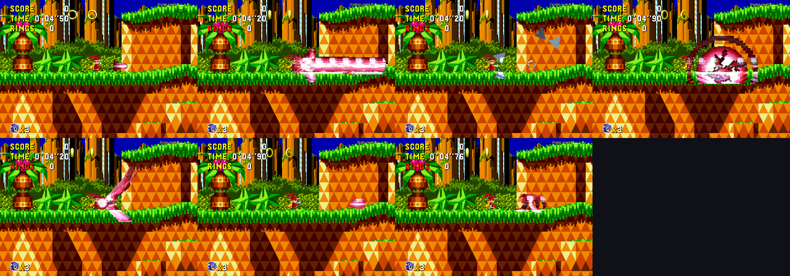

---

## Como funciona

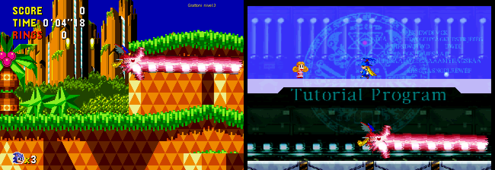

*À esquerda, o que o jogador vê. À direita, o que o Silhouette Mirage está fazendo de verdade naquele instante.*

Três ideias sustentam tudo:

**1. O Sonic vira o corpo invisível da Shyna.** Ele continua existindo na fase, só que sem ser desenhado. A cada quadro o programa o empurra com o movimento que a Shyna fez no jogo dela. Quem resolve chão, rampa, parede, plataforma e argola é o próprio Sonic CD, então não foi preciso entender a colisão de nenhum dos dois jogos.

**2. O Silhouette Mirage vira uma esteira.** Ele fica preso na sala de tutorial. Antes de cada quadro a Shyna é recolocada no mesmo ponto; o programa só aproveita *quanto* ela se moveu naquele quadro. Quando o corpo no Sonic CD está no ar, ela é mantida flutuando na sala; quando ele pousa, ela é encostada no chão.

**3. A imagem dela é recortada por diferença.** O fundo da sala de treino é estático. O programa guarda uma foto da sala vazia e, a cada quadro, tudo que for diferente dela (a Shyna, os tiros, os efeitos) é recortado e colado sobre a tela do Sonic CD, na posição do corpo.

Em cima disso vêm os detalhes:

- **Ataques:** qualquer coisa que o Silhouette Mirage desenhe fora do contorno da Shyna é um ataque. Se encostar num inimigo do Sonic CD, ele é destruído; se encostar numa TV, ela abre.
- **Dano:** o corpo é vulnerável de verdade. Quem tira as argolas e mata é o Sonic CD.
- **Agarrar:** o inimigo de treino do Silhouette Mirage fica invisível e é posicionado, na sala, no mesmo lugar relativo do inimigo do Sonic CD mais próximo. Quando ela o agarra, soca ou arremessa, o programa espelha isso no inimigo real.
- **Quem manda no movimento:** normalmente a Shyna. Quando a fase impõe uma velocidade que ela não produziria sozinha (lançador, mola, rampa em alta velocidade), a física do Sonic assume até ela pousar ou voltar ao ritmo dela.

Tudo isso é feito lendo e escrevendo a memória dos dois jogos enquanto rodam em [núcleos libretro](https://www.libretro.com/) carregados no mesmo processo.

---

## A jornada, passo a passo

Este projeto foi feito em uma conversa de cerca de um dia entre uma pessoa e o Claude, a IA da Anthropic. A pessoa trouxe a ideia, tomou as decisões de rumo e testou; a IA investigou, escreveu o código e rodou os experimentos. O que segue é o caminho real, incluindo os erros.

### 1. A ideia

Tudo começou com o [SkyCraft](https://github.com/chasmlol/SkyCraft), um projeto que deixa jogar Skyrim com as mecânicas do Minecraft. A primeira hipótese era que seria preciso descompilar os jogos, começando pelo Silhouette Mirage, "linha por linha para C".

Olhando o SkyCraft de perto, a surpresa: **ele não descompila nada**. São dois programas rodando juntos (um plugin no Skyrim, um mod no Minecraft) que conversam por memória compartilhada.

### 2. Olhando dentro do disco

Antes de decidir, valia medir o tamanho do problema. O disco do Silhouette Mirage revelou:

- versão Saturn japonesa, T-32901G V1.003, de 30/07/1997;
- código SH-2 cru, sem compressão;
- um núcleo de 82 KB carregado em `0x06003000` e outros 37 executáveis (um por fase, mais título, opções etc.) carregados em `0x06040000`;
- 13,4 MB de executáveis, dos quais no máximo 3,4 MB são únicos;
- uma estimativa de 5 a 8 mil funções.

Uma descompilação legível disso seria um projeto de meses ou anos, e ainda sobraria reescrever vídeo, som e CD. **Decisão: nada de descompilar. Fazer como o SkyCraft, com emuladores no lugar dos mods.** E a fusão escolhida foi a Shyna dentro das fases do Sonic CD.

### 3. Discos que os emuladores aceitam

As cópias estavam no formato "ISO mais faixas em MP3", que os emuladores não leem. Além disso, o `.cue` do Silhouette Mirage deixava as músicas cerca de 2 segundos fora do lugar, e esse jogo toca música por posição no disco.

A solução veio do próprio jogo: o sistema de arquivos do disco lista cada faixa de áudio com sua posição exata. O script [`tools/build_disc.py`](tools/build_disc.py) lê essa lista e recoloca as 25 faixas no lugar certo.

### 4. Um hospedeiro próprio

Em vez de usar dois emuladores separados, a IA escreveu um pequeno "frontend" em Python ([`host/retro.py`](host/retro.py)) que carrega os núcleos libretro direto, dentro de um único processo. Ele avança os jogos quadro a quadro, injeta controle, tira capturas de tela e dá acesso à memória.

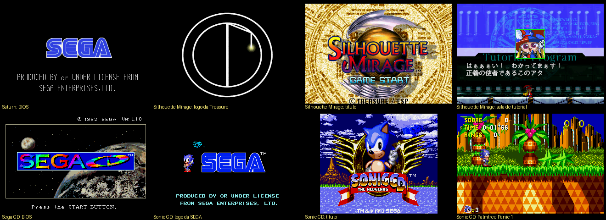

Isso foi o que tornou todo o resto possível: a IA passou a poder jogar sozinha, por roteiro, e conferir o resultado olhando capturas de tela.

### 5. Achando as personagens na memória

Como achar a posição da Shyna em 2 MB de memória? Com um experimento automático: segurar direita, parar, segurar esquerda, parar, e filtrar os endereços cujo valor acompanha exatamente esse movimento.

De 1 milhão de candidatos sobraram 10. A posição X dela estava em `0x060B6518`. Do lado do Sonic foi mais fácil: o Sonic CD usa o mesmo formato de objetos do Sonic 1, com o jogador em `$FFD000`.

### 6. A ideia central

O plano óbvio era ensinar o Silhouette Mirage a entender o cenário do Sonic CD, o que exigiria desmontar a colisão dele. A alternativa encontrada foi virar o problema de cabeça para baixo: **deixar o Sonic na fase, invisível, como corpo, e usar o Silhouette Mirage só como esteira.**

Três testes confirmaram que as peças se comportavam:

- recolocando a Shyna no lugar a cada quadro, ela anda "na esteira" a exatos 2,00 pixels por quadro;
- levantando-a do chão, o jogo percebe sozinho, aplica gravidade e a faz pousar;
- o Sonic, movido por fora sem nenhum botão apertado, anda acompanhando as rampas e até coleta argolas.

### 7. A primeira vez

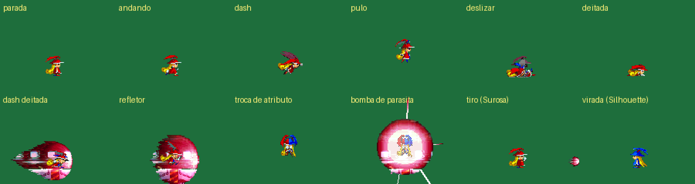

*A Shyna recortada do jogo dela, pose por pose.*

Juntando tudo, ela apareceu na Palmtree Panic: andando, pulando, virando (azul para a esquerda, vermelha para a direita), com a câmera acompanhando.

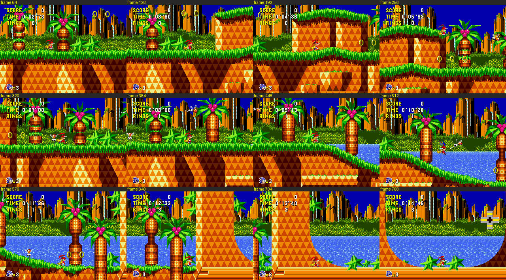

### 8. O tutorial como manual

Os outros golpes não respondiam. A solução foi usar o próprio jogo como documentação: o tutorial do Silhouette Mirage tem 15 lições, e a IA percorreu todas lendo o texto em japonês das capturas de tela. De lá saiu a lista completa: dash, deslizar, deitar, bomba, refletor, agarrar, os arremessos e a troca de atributo.

### 9. Dano e inimigos

Para esconder o Sonic, a primeira versão usava o contador de "piscar após dano" dele, que também o deixava invulnerável. Para ela poder tomar dano foi preciso outro truque: apontar o mapa de sprites do Sonic para um trecho de memória cheio de zeros. Todo quadro de animação passa a ter zero peças: ele some, mas continua vulnerável.

Para matar inimigos, a IA observou o jogo destruindo um do jeito normal e viu que o objeto simplesmente vira o objeto `18` (a explosão), que solta a semente sozinho. Fazer a mesma troca por fora dá o mesmo resultado.

### 10. O lançador

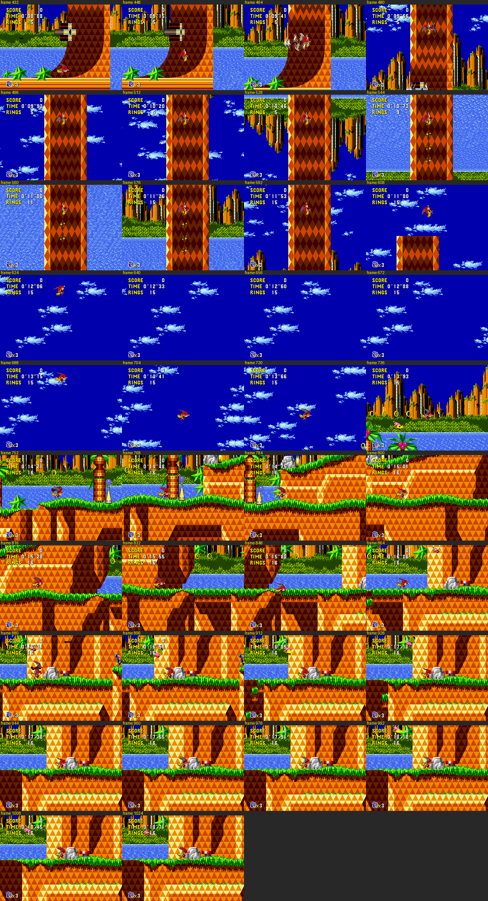

No começo da fase há uma rampa que termina num lançador. A Shyna subia a rampa e ficava presa, oscilando. O motivo: o jogo reescreve a velocidade do Sonic a cada quadro naquele trecho, e o programa também, um desfazendo o outro.

A saída foi uma regra geral de arbitragem: se a velocidade do corpo depois do quadro for uma que a Shyna não poderia ter produzido, é a fase que está mandando, e o programa para de interferir até ela pousar. Com isso ela é disparada pelo poço, faz o arco pelo céu e pousa na rota de cima, igual ao Sonic.

### 11. Agarrar

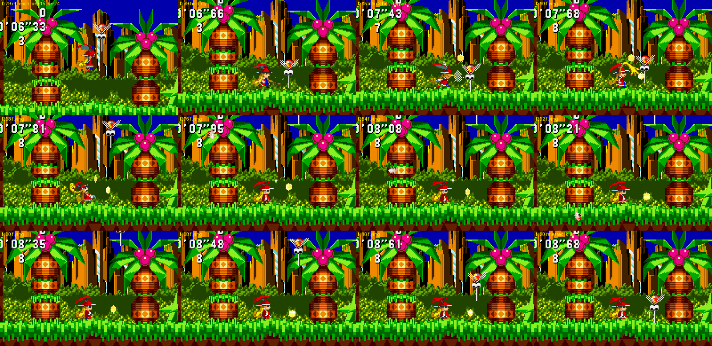

Os inimigos do Sonic CD não existem dentro do Silhouette Mirage, então não há o que agarrar. A ideia foi usar o inimigo de treino do tutorial como **dublê**.

Deu três problemas em sequência:

- **Na lição 1 não dá para agarrar.** Só o inimigo da lição 9 ("agarrar o inimigo") é agarrável. A sala de esteira mudou para lá.
- **A lição termina.** Quando o jogador cumpre o objetivo, o tutorial mostra "OK." e segue para a próxima lição, quebrando tudo. A IA resolveu por busca: listou os 498 bytes que mudavam após o agarrão, restaurou grupos deles a cada quadro e foi cortando pela metade o grupo que impedia a lição de terminar. Sobrou **um único byte**, `0x060C6CBD`. Mantido no valor 2, a lição nunca termina.
- **O dublê aparece na tela.** Outra busca automática achou um byte do objeto dele que o deixa invisível sem afetar a lógica.

### 12. A caça aos parasitas

Esta foi a parte mais longa, e a que teve o maior erro.

Por um bom tempo a IA procurou onde o jogo guarda a arma equipada, testando centenas de bytes e lendo código desmontado, sem sucesso. O tiro nunca mudava. A pista veio de uma busca na web: o jogo tem um **modo de depuração escondido** (segurar X, B e Z e apertar Start no logo da Treasure) que libera um seletor de fases e faz as lojas venderem todos os parasitas.

A fase 1-1 travava na batalha de abertura. A pessoa sugeriu "hackear" a passagem; as duas tentativas nessa linha (teletransportar a Shyna e zerar a vida dos inimigos) não destravaram a arena. O que resolveu foi **usar o seletor para olhar o começo de todas as fases de uma vez** e achar uma que começasse perto da loja: a 2-2 começa ao lado dela.

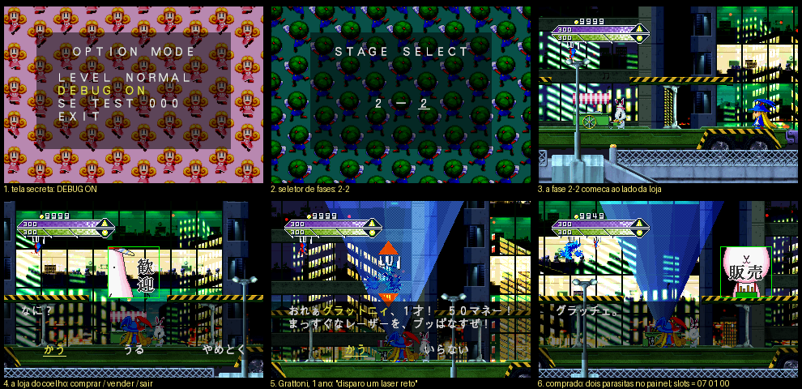

Comprando dois parasitas diferentes a partir do mesmo ponto e comparando a memória, o inventário apareceu: três bytes em `0x06002050`, cada um valendo `tipo × 6 + nível`.

E aí veio a descoberta que explicava tudo: **o botão de tiro era outro.** O tutorial nunca diz qual botão atira. O que vinha sendo usado como "tiro" (o botão A) era o **refletor**. O tiro do parasita é o botão B, que nunca tinha sido repassado ao jogo. A Shyna estava jogando sem arma desde o começo.

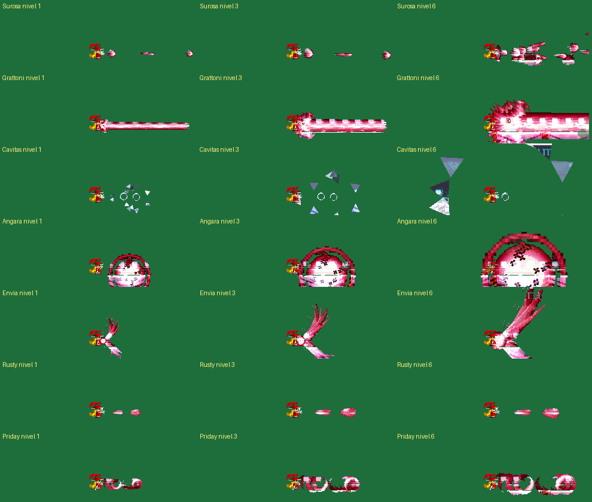

Escrevendo no primeiro byte do inventário, o parasita muda na hora.

### 13. As TVs

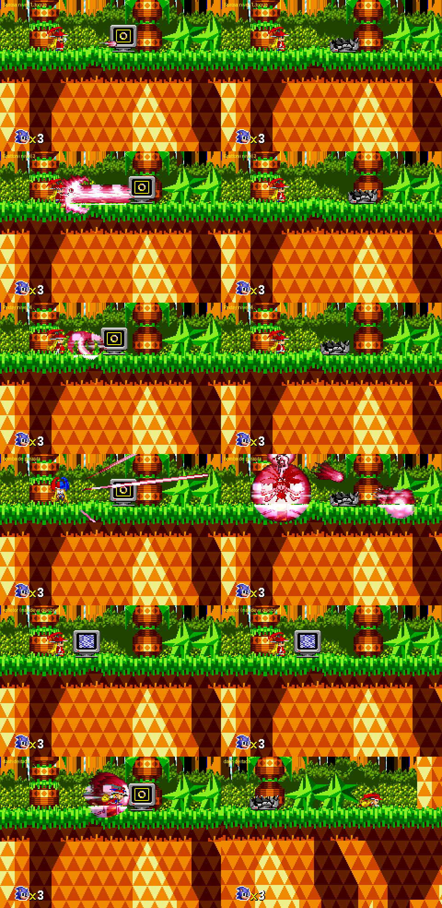

Por último, os ataques não quebravam as TVs de item, porque para o Sonic CD elas são outro tipo de objeto. Mesma receita dos inimigos: observar o jogo quebrando uma e copiar. A TV abre quando a "rotina" dela passa de 2 para 4, e daí em diante ela mesma solta o item e a explosão.

### O que essa jornada ensinou

- **Não precisar entender tudo.** Nenhum dos dois jogos foi descompilado. Quase tudo foi feito deixando cada jogo fazer o que já sabe fazer.
- **O jogo é a melhor documentação de si mesmo.** O tutorial ensinou os golpes, a loja ensinou os nomes dos parasitas, e observar o jogo destruir um inimigo ensinou como destruir um inimigo.
- **Experimento automático vence leitura de código.** Segurar direita e esquerda achou a posição; cortar pela metade achou o byte da lição; comprar duas coisas diferentes achou o inventário.
- **Conferir a suposição mais básica.** O maior atraso veio de assumir, sem testar, qual era o botão de tiro.

---

## Mapa de memória

Endereços válidos apenas para as versões indicadas em [Como rodar](#como-rodar).

### Silhouette Mirage (na sala de tutorial)

| Endereço | Conteúdo |
|---|---|
| `0x060B6500` | objeto da Shyna |
| `+0x18`, `+0x1C` | posição X e Y (ponto fixo 16.16) |
| `+0x28` | velocidade vertical (16.16) |
| `+0x5C` | golpe atual (byte alto) |
| `+0xF0` | vida máxima, vida, espírito máximo, espírito |
| `0x060B7000` | inimigo da lição, mesmo formato |
| `+0x3C` do inimigo | zerado, ele não é desenhado |
| `0x060C6CBD` | fase do tutorial; 2 enquanto o treino roda |
| `0x06002050` | inventário: 3 parasitas, `tipo × 6 + nível`, 0 = vazio |

Golpes (byte alto de `+0x5C`): `02` dash, `04`/`05` pulo e queda, `12`/`13`/`14` arremessos, `16` dar a volta, `17` deslizar, `18` bomba, `19`/`1A` deitar, `1B` dash deitada, `1C` refletor, `1D` agarrando, `1E` troca de atributo.

Estados do inimigo: `00` parado, `0A` arremessado, `0B` no chão, `0C` levantando, `0F` agarrado.

### Sonic CD

| Endereço | Conteúdo |
|---|---|
| `$FFD000` | objeto do Sonic (mesmo formato do Sonic 1) |
| `+$04` | ponteiro do mapa de sprites |
| `+$08`, `+$0C` | posição X e Y |
| `+$10`, `+$12`, `+$14` | velocidade X, Y e velocidade no chão |
| `+$22` | estado (bit 1 = no ar) |
| `+$24` | rotina (2 = controle normal, 4 = ferido, 6 = morrendo) |
| `+$26` | ângulo do chão |
| `+$30` | contador de invulnerabilidade |
| `$FFD800`–`$FFEFFF` | objetos da fase, 0x40 bytes cada |
| `$FFF700`, `$FFF704` | câmera X e Y |
| `$FF1512`, `$FF150F` | argolas, e o aviso para o painel redesenhar |

Objetos: inimigo = byte de colisão (`+$20`) entre `01` e `3F`; explosão = objeto `18`; TV = objeto `19` com colisão `46`, que abre quando a rotina passa de 2 para 4.

---

## Estrutura do projeto

```
host/
  retro.py     carrega um núcleo libretro: quadros, controle, vídeo, memória
  games.py     os dois jogos: como chegar na fase, botões, endereços de memória
  fusion.py    o laço de fusão e a janela
tools/
  build_disc.py   converte uma cópia ISO + MP3 para o formato dos emuladores
  run_core.py     roda um jogo sozinho, com roteiro de botões e capturas de tela
docs/img/      as imagens deste texto
bios/ cores/ discs/   vazias; cada uma tem um LEIA-ME dizendo o que colocar
```

Pastas criadas ao rodar e nunca publicadas: `states/` (pontos salvos), `saves/`, `out/`.

---

## Créditos e avisos

- _Silhouette Mirage_ © Treasure / ESP. _Sonic the Hedgehog CD_ © SEGA. Este é um projeto de fã, sem fins lucrativos e sem ligação com as empresas.
- As capturas de tela mostram os jogos originais e estão aqui apenas para ilustrar o texto.
- A emulação é feita pelos núcleos [Genesis Plus GX](https://github.com/libretro/Genesis-Plus-GX) e [Beetle Saturn](https://github.com/libretro/beetle-saturn-libretro), do projeto libretro. Eles não são distribuídos aqui.
- A inspiração veio do [SkyCraft](https://github.com/chasmlol/SkyCraft).
- Código e investigação feitos com o [Claude Code](https://claude.com/claude-code).
